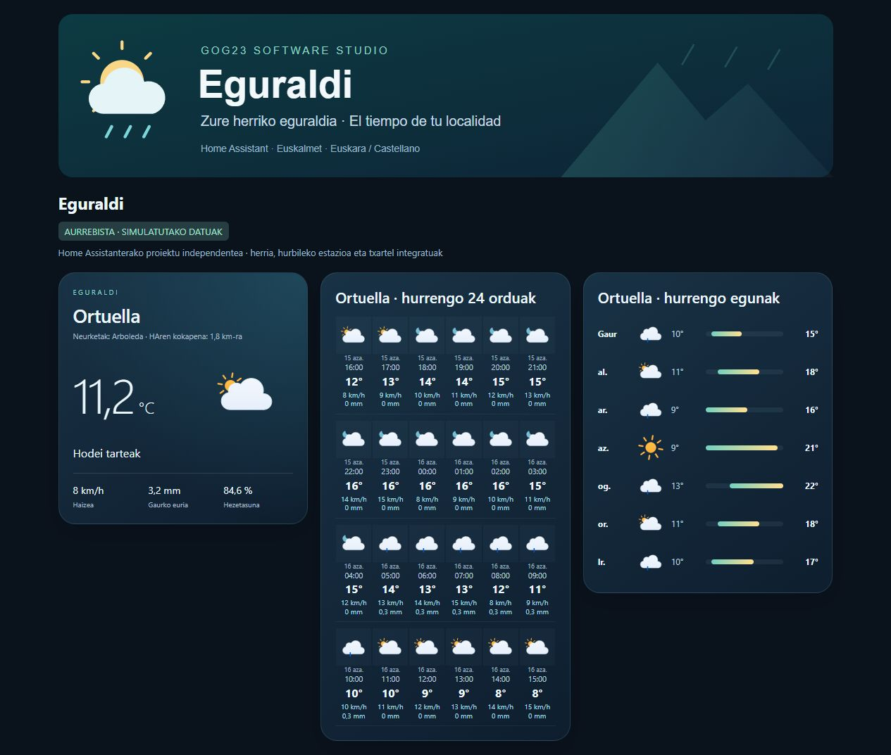
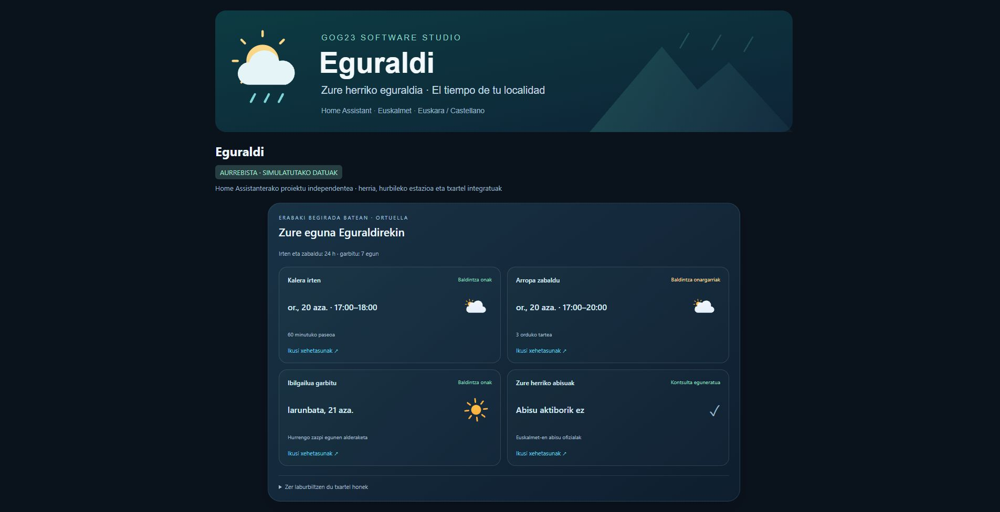
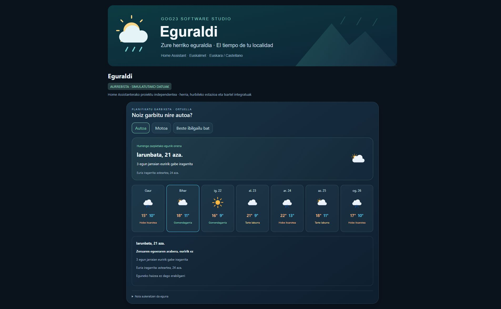
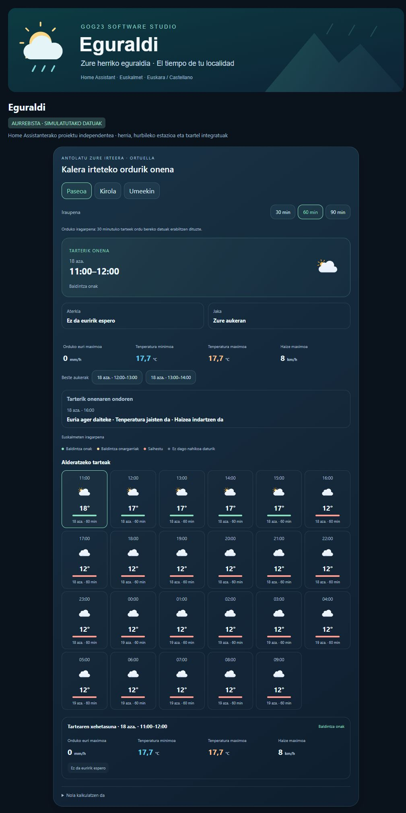
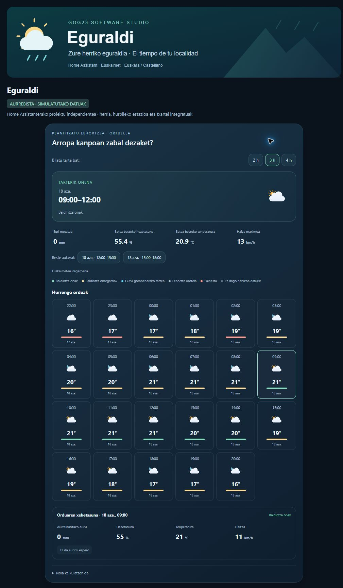
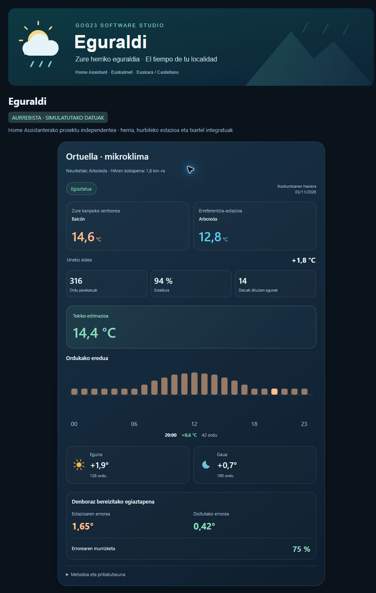
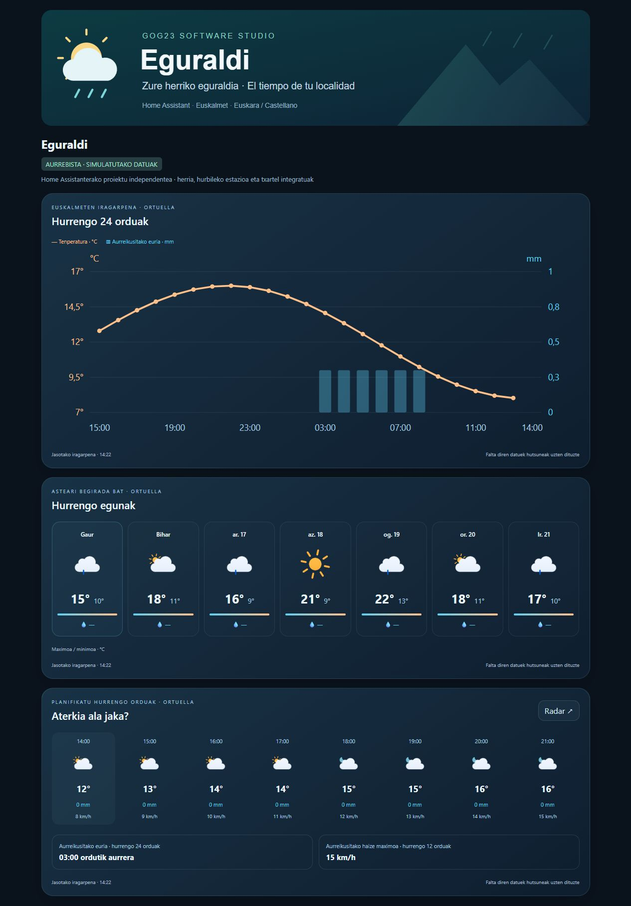
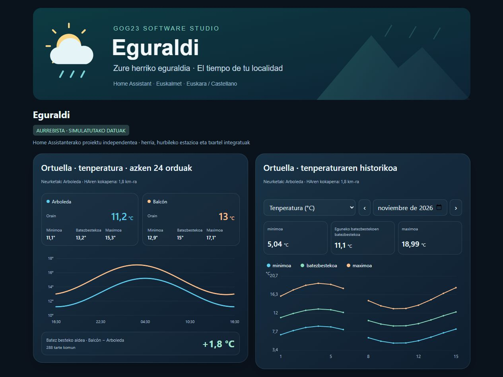
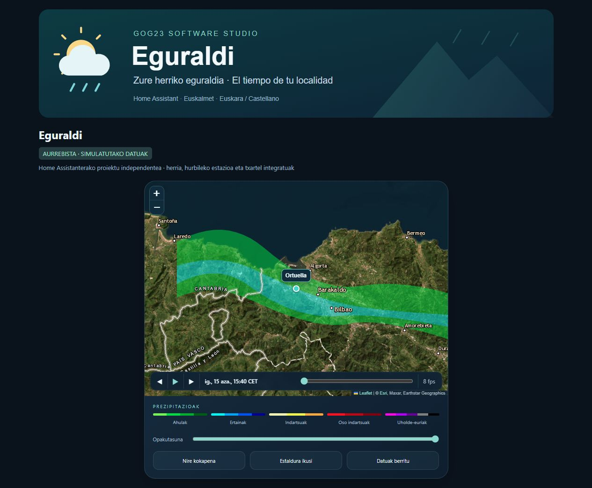
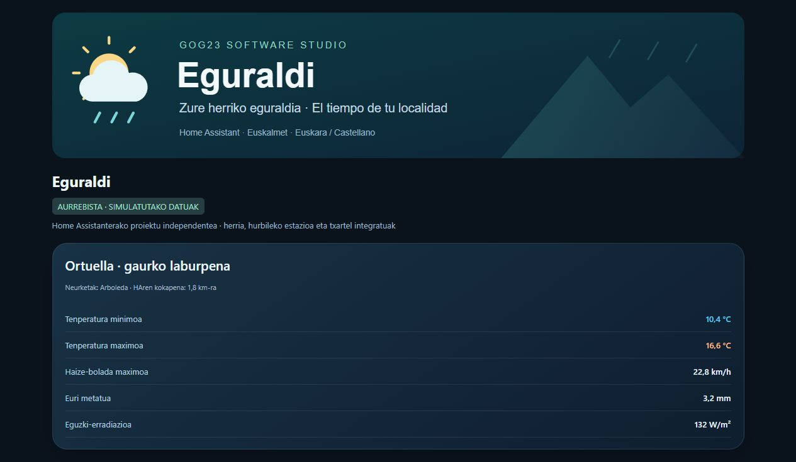

# Eguraldi

**Euskara** · [Leer en castellano](README.md)

[GOG23 Software Studio](https://github.com/GOG23-Software-Studio) proiektua · Mantentzailea: [@oyogor1985](https://github.com/oyogor1985)

Euskalmeteko eguraldia Home Assistanten: hurbileko estazioen neurketak, orduko eta eguneko iragarpenak, abisuak, radarra eta txartel integratuak.

[](https://github.com/GOG23-Software-Studio/eguraldi/actions/workflows/ci.yml)
[](https://github.com/GOG23-Software-Studio/eguraldi/releases)

**0.4.2 bertsioa.** Komunitate-proiektu independentea, Euskalmetekin edo Eusko Jaurlaritzarekin lotura ofizialik gabea.



[Ikusi mugikorreko ikuspegia](docs/preview-mobile.jpg) · [Ikusi editore bisuala](docs/preview-editor.jpg)

## Zure eguna Eguraldirekin

Zure herrirako laburpen praktikoa: kalera irteteko tarterik onena, arropa zabaltzeko tartea, ibilgailua garbitzeko eguna eta abisu ofizialak. Bloke bakoitzak xehetasunak irekitzen ditu paneletik irten gabe. Baldintza okerrak, orientazio partziala eta datu erabilgaitzak bereizten ditu; ordutegiek beti erakusten dute data.



[Laburpenaren aukerak](docs/day-summary-editor-eu.jpg): ikusgai dauden blokeak, ordena, irteerako jarduera eta iraupena, eta arropa esekitzeko tartea. Txartel bakoitzean gordetzen dira ikusizko editoretik.

[Mugikorreko ikuspegia](docs/day-summary-mobile-eu.jpg) · [Konfigurazioa eta mugak](docs/DAY_SUMMARY.md) (gaztelaniaz). Editorean **Zure eguna Eguraldirekin** (`mode: day_summary`) eta panel osoko **Zure eguna** fitxan eskuragarri.

## Noiz garbitu nire ibilgailua?

Konparatu hurrengo zazpi egunak edozein ibilgailu garbitzeko. Euririk gabe iragarritako egun segida luzeenaren lehen eguna nabarmentzen du, gutxienez bi egun jarraian badaude. Egun bakoitza kontsulta dezakezu, iragarpena non aldatzen den edo datuak non falta diren ikusteko.

Ez du bermatzen zenbat ordu izango diren euririk gabe edo ibilgailuak zenbat iraungo duen garbi. Euskalmet-ek ez du euri probabilitaterik edo haizerik ematen eguneko iragarpenean. Ibilgailu guztiek irizpide bera erabiltzen dute. [Metodoa eta konfigurazioa](docs/VEHICLE_WASH.md) (gaztelaniaz).



[Mugikorreko ikuspegia](docs/vehicle-wash-mobile-eu.jpg). Editorean **Noiz garbitu nire ibilgailua?** (`mode: vehicle_wash`) eta panel osoko **Ibilgailua garbitu** fitxan eskuragarri.

## Kalera irteteko ordurik onena

Aukeratu **Paseoa**, **Kirola** edo **Umeekin**, eta **30, 60 edo 90 minutuko** iraupena. Txartelak hurrengo 24 orduetako tarte onena eta bi aukera gehigarri bilatzen ditu. Aterkiari eta jakari buruzko orientazioa ematen du eta, ondorengo sei orduetan datuak badaude, euriaren, tenperaturaren edo haizearen lehen okerragotzea erakusten du.

Tarte bakoitzak aurreikusitako haize maximoa ere erakusten du tenperaturaren azpian, Arropa zabaldu ikuspegiaren estilo berarekin.

Iragarpena ordukoa da: ordu erdiko irteerek ordu-bloke berak erabiltzen dituzte, datuak asmatu gabe. Zeharkatutako ordu guztietan datuak behar dira. Ez du Mikroklima edo beste hornitzailerik behar. [Arauak eta konfigurazioa](docs/OUTING.md) (gaztelaniaz).



[Mugikorreko ikuspegia](docs/outing-mobile-eu.jpg). Editorean **Kalera irteteko ordurik onena** (`mode: outing`) eta panel osoko **Kalera irten** fitxan eskuragarri.

## Arropa kanpoan zabal dezaket?

**Arropa zabaldu** ikuspegiak (`mode: drying`) hurrengo 24 orduetako 2, 3 edo 4 ordu osoko tarterik onena eta beste aukerak bilatzen ditu. Euria, tenperatura, hezetasuna eta haizea alderatzen ditu; haizearen abiadura ordu bakoitzaren azpian ere agertzen da. Sakatu ordu bat datuak eta arrazoiak ikusteko, haize leunak lehortzen nola laguntzen duen barne. Editorean herri bereko beste orduko iragarpen bat hauta daiteke **hezetasun osagarri** gisa: aldagai hori soilik erabiltzen da, iturria adieraziz.

Eguraldik gaur egun argitaratzen duen iragarpenak ez du orduko hezetasunik. Osagarririk gabe orientazio partziala ematen da, hezetasuna asmatu gabe eta uneko neurketa iragarpen gisa erabili gabe. Ez du Mikroklima edo sentsore propiorik behar. [Konfigurazioa eta arauak](docs/DRYING.md) (gaztelaniaz).



[Mugikorreko ikuspegia](docs/drying-mobile-eu.jpg). Hautatutako iraupena bilatutako tartea da, ez arropa lehortzeko denboraren bermea.

## Kanpoko arroparen abisuak

**Aukerakoak eta lehenespenez desaktibatuta erabiltzaile guztientzat.** Herri bakoitzaren aukeretan hautatu hartzailea, euria eta/edo haize zakarra, haizearen muga, aurrerapena, ordutegia eta abisuen arteko tartea. Ondoren, markatu **Arropa kanpoan dut** txartelean, eta **Arropa jaso dut** amaitzean. Jarraipenak txartela itxita ere funtzionatzen du eta 24 ordura iraungitzen da.

Iragarpena ordukoa da eta aurrerapena orientagarria. Arrisku mota bakoitzeko abisu bat saio bakoitzean, berrabiaraztean bikoiztu gabe. Ez da abisurik bidaltzen funtzioa konfiguratu, aktibatu eta saioa hasi arte. [Konfigurazioa eta mugak](docs/LAUNDRY_ALERTS.md) (gaztelaniaz).

## Zure etxeko mikroklima

Eguraldi 0.2k tokiko ikaskuntza gehitzen du kanpoko sentsore propioarekin: ordukako eta egun/gauko aldeak, datuen estaldura eta egun bereizietan egindako egiaztapena. Estimazioa estazioarekiko hobekuntza frogatzen denean soilik aktibatzen da. **Ez du iragarpen ofiziala zuzentzen.**

Aktibatu **Ezarpenak → Gailuak eta zerbitzuak → Eguraldi → Konfiguratu → Zure etxeko mikroklima** atalean. Aukeratu eguzki zuzenetik babestutako kanpoko sentsorea. Uneko eguraldiaren bloke zabalgarrian eta txartelen editoreko **Mikroklima** ikuspegian agertzen da.

Ikaskuntza aktibatzean hasten da. Gutxienez bost egun behar ditu ikasteko eta beste bi egun oso emaitza egiaztatzeko. Sentsorea, estazioa edo herria aldatzean epea berrabiarazten da. Dena HAn prozesatzen da, Euskalmeti kontsulta gehigarririk egin gabe. [Metodoa eta mugak](docs/MICROCLIMATE.md) (gaztelaniaz).

Grafikoak zure sentsorea, estazioa eta tokiko doikuntza alderatzen ditu egiaztatzeko gordetako bi egunetan. Aurreko eta ondorengo erroreak, egun bakoitzeko hobekuntza eta aktibatzeko baldintzak erakusten ditu. Aurrerapen-barrek orduak, ikasteko egunak eta egiaztatzeko egunak bereizten dituzte; estaldura eskasa duten egunek ez dute balio.



[Mugikorreko ikuspegia](docs/microclimate-mobile-eu.jpg) · [Ikaskuntza-egoera](docs/microclimate-learning-eu.jpg). Irudiek simulatutako datuak erabiltzen dituzte; «Egiaztatua» egoerak baldintzak bete ondorengo emaitza erakusten du, ez hasierako egoera.

## Instalazioa

[**Ireki Eguraldi HACSen**](https://my.home-assistant.io/redirect/hacs_repository/?owner=GOG23-Software-Studio&repository=eguraldi&category=integration)

Estekak ez badu funtzionatzen, gehitu `https://github.com/GOG23-Software-Studio/eguraldi` HACS / Marketplace-n, biltegi pertsonalizatu gisa, **Integrazioa** kategorian.

1. Instalatu Eguraldiren azken bertsioa eta berrabiarazi Home Assistant.
2. Joan **Ezarpenak → Gailuak eta zerbitzuak → Gehitu integrazioa → Eguraldi** atalera.
3. Sartu [Open Data Euskadiko](https://api.euskadi.eus/opendata-apikey/#/) kontuaren helbide elektronikoa eta `privatekey.pem` fitxategiaren eduki osoa.
4. Utzi **Home Assistant-en kokapena** hautatuta, edo aukeratu **Beste herri bat**. Berrikusi udalerria eta estazioa gorde aurretik.
5. Gehitu **Eguraldi** txartela zure panelera. Aukeratu ikuspegia eta kokapena editore bisualean.

Home Assistant **2026.8 edo berriagoa**, Internet eta Open Data Euskadiko doako kontua behar dira. Aktibazio-mezua ez bada iristen, begiratu spam karpeta edo saiatu **Google bidez sartzen**. Laguntzaileak gakoak deskargatzeko esteka du.

Eguraldi **HACSeko biltegi pertsonalizatu** gisa instalatzen da. Katalogo orokorrean sartzeko [eskaera](https://github.com/hacs/default/pull/14144) 2026ko azaroaren 17an itxi zen, onartu gabe, aktibo jarraitzen duen jatorrizko Euskalmet integrazioaren antzekoa delako. Horrek ez die eragiten biltegi pertsonalizatu honetako instalazioari eta eguneraketei.

[Instalazioari, eguneraketei eta arazoei buruzko gida (gaztelaniaz)](docs/INSTALLATION.md)

## Zer eskaintzen du?

- Uneko eguraldia eta eguneko, hileko eta urteko laburpen meteorologikoak.
- Hurrengo 24 orduak: sei orduko lau errenkada, ikono animatuekin eta alboko korritzerik gabe.
- Zazpi eguneko iragarpena, ikonoekin eta tenperatura minimo/maximoen barrekin.
- Kokapenean zentratutako radar animatua, markatzailea, hurbileko zooma, **Nire kokapena** eta **Estaldura ikusi** botoiak.
- Hileko historikoa eta etxeko tenperatura-sentsore batekin konparazioa.
- Abisuak, itsas iragarpena, mareak eta polena.
- Txartel integratuak, Mushroom, button-card edo beste osagarririk gabe.

## Kokapena eta estazioa

Lehenetsitako aukerak HAren kokapena erabiltzen du. Udalerria lokalean identifikatzen da, geoEuskadiko kartografia integratuarekin: **etxeko koordenatuak ez dira geokodetzaile batera bidaltzen**. Estazio automatikoa puntu horretatik hurbilen dagoen estazio bateragarria da. HAren kokapen orokorra aldatuz gero, lotutako sarrera eguneratzen da; eskuz aukeratutako herriek independente jarraitzen dute.

**Konfiguratu** atalean herria edo estazioa alda dezakezu. Irekita dauden txartelen izenburuak, distantziak, laburpenak eta historikoa berriro kargatu gabe eguneratzen dira. Entitateen identifikatzaileak mantentzen dira. Beste herri bat gordetzean estazio automatikoa berrezartzen da.

Beste herri bat gehitzeko, sakatu **Gehitu zerbitzua** eta berrerabili HAn gordetako kontua, gakoa berriro sartu gabe. Gehitu haren txartelak eta hautatu kokapena editore bisualean.

## Hizkuntza

Konfigurazioa eta txartelak **euskaraz eta gaztelaniaz** erabil daitezke. Txartelek Home Assistant-eko profilaren hizkuntza jarraitzen dute, eta hura aldatzean eguneratzen dira. Herrien eta estazioen izenak mantentzen dira; hornitzailearen testu ofizialak jatorrizko hizkuntzan erakusten dira.

## Txartelak

**Gehitu txartela → Eguraldi** atalean, editoreak ikuspegia eta kokapena hautatzeko, radarraren zooma doitzeko eta konparatzeko sentsorea aukeratzeko aukera ematen du. Ez da identifikatzailerik idatzi behar.

YAML ere erabil dezakezu:

```yaml
type: custom:euskalmet-local-card
mode: dashboard
```

| Ikuspegia | `mode` |
| --- | --- |
| Panel osoa | `dashboard` |
| Zure eguna Eguraldirekin | `day_summary` |
| Uneko eguraldia | `overview` |
| Hurrengo 24 orduak | `hourly` |
| Hurrengo egunak | `daily` |
| Tenperaturaren eta euriaren grafikoa · 24 ordu | `hourly_chart` |
| Asteko ikuspegia, maximo eta minimoekin | `daily_tiles` |
| Hurrengo orduak planifikatu | `planning` |
| Gaurko laburpena | `summaries` |
| Mikroklima | `microclimate` |
| Arropa zabaldu | `drying` |
| Kalera irteteko ordurik onena | `outing` |
| Ibilgailua garbitu | `vehicle_wash` |
| Hileko historikoa | `history` |
| Radarra | `radar` |
| Abisuak | `alerts` |
| Tenperaturen konparazioa | `comparison` |
| Kostaldea eta ingurumena | `environment` |

Kokapen bakarra badago, automatikoki hautematen da. Hainbat badaude, gorde kokapena editorearen bidez; YAMLen `entry_id` erabil daiteke. Baliabideak automatikoki erregistratzen dira. Instalazioak ez ditu panel pertsonalak sortzen edo aldatzen.



Grafikoak tenperatura eta orduko euria (mm) bereizten ditu. Asteko ikuspegiak hornitzaileak argitaratutako euri-datuak soilik erakusten ditu. Planifikatzaileak haize-boladak eta aurreikusitako haize maximoa bereizten ditu, eta radarra zabaltzeko botoia du. Radarrak satelite-mapa erabiltzen du lehenespenez, goiko izenbururik gabe; editorean beste mapa bat hauta daiteke. Abisuek goiburu bakarra dute.



Historikoak neurriaren eta hilabete/urtearen hautagailu propioak ditu, atzeko plano ilunarekin, teklatu bidezko nabigazioarekin eta euskarazko datekin.





Radarrak gainerako txartelen atzeko planoa eta kontrolen estiloa erabiltzen ditu. Eguneko barrek minimoa eta maximoa erakusten dituzte asteko eskala komun batean. Irudiek erakustaldiko datuak eta herriaren kokapen publikoa erabiltzen dituzte.

Konparazioak HAko bost minutuko tarte osatuen estatistikak erabiltzen ditu: serie bakoitzaren minimoak, maximoak eta batezbestekoak. Batez besteko aldea tarte komunekin soilik kalkulatzen da, unitate berean. Hileko historikoak eguneko laburpen ofizialak erakusten ditu, daturik gabeko egunetan hutsuneak utziz eta uneko hilabeteko etorkizuneko egunak marraztu gabe.

## Datuen indarraldia eta berreskurapena

Orduko eta eguneko iragarpenen indarraldia behaketetatik bereizita kudeatzen da. Iraungitzen badira, gomendioak eteten dira eta HAko iragarpen estandarrek ez dituzte datu zaharrak itzultzen. Txartelak automatikoki berriro saiatzen dira huts egindako harpidetzekin. [Jokabidea, diagnostikoak eta berrikuspenaren mugak](docs/RELIABILITY.md) (gaztelaniaz).

## Datuen esanahia eta mugak

Estazioak bere kokapenean eta altitudean neurtzen du. Tenperatura argitaratzen duten estazio aktiboak hautatzen dira, 120 km baino gutxiagora; beste magnitude batzuk falta daitezke. Hurbiltasunak ez ditu etxeko baldintza berdinak bermatzen.

Iragarpena eta abisuak herriari dagozkio, estazioa aldatu arren. Radarra eskualdekoa da; itsasoak eta mareek Kantauri itsasoko eta Pasaiako erreferentziak erabiltzen dituzte. Polenak erreferentziako neurgailuaren argitaratutako lagina adierazten du.

Txartelak Euskalmeten jatorrizko hezetasuna erakusten du, baita % 100etik gorakoa ere. `raw_value` eta `quality` atributuek neurketa eta kalitatea gordetzen dituzte. HAn gordetako neurketak mantentzen dira estazioa aldatzean; hileko historikoak hautatutako estazioa kontsultatzen du.

Tokiko udalerri-detekzioak integratutako Euskadiko poligonoak hartzen ditu. Estalduratik kanpo, muga zalantzagarrietan edo iragarpen argirik ez dagoenean, eskuz aukeratzeko aukera eskaintzen da.

## Pribatutasuna eta laguntza

Helbide elektronikoa eta gakoa HAn gordetzen dira; Euskalmetera sartzeko eskaerak bertan sinatzen dira. Txartelek eta editoreak ez dute gakoa jasotzen. Eskuzko bilaketak udalerriaren izena soilik bidaltzen dio Open-Meteo / GeoNames zerbitzuari. Mapak Esriren teselak erabiltzen ditu lehenetsitako satelite-estiloan, edo OpenStreetMapenak dagozkien estiloetan. Proiektuak ez du telemetriarik.

[Ireki arazo bat](https://github.com/GOG23-Software-Studio/eguraldi/issues/new/choose), bertsioak eta urratsak adieraziz. Ez argitaratu gakorik, helbide elektronikorik edo koordenaturik. [VALIDATION.md](VALIDATION.md) fitxategiak probak eta haien mugak azaltzen ditu (gaztelaniaz).

`euskalmet_local` domeinua mantentzen da aurreko bertsioekin bateragarri izateko. Beste integrazioekin batera instala daiteke eta ez ditu automatikoki desinstalatzen.

## Kredituak eta lizentzia

MIT. Euskalmeteko konexioa eta plataformak [mitxol/home-assistant-euskalmet v2.12.9](https://github.com/mitxol/home-assistant-euskalmet/tree/v2.12.9) proiektuan oinarritzen dira, Copyright 2026 Mitxol. Herrien laguntzailea, estazio-hautaketa eta txartel integratuak GOG23 Software Studioren lana dira.

Datuak: Euskalmet / Open Data Euskadi. Geokodetzea: Open-Meteo / GeoNames. Ikonoak: Meteocons, Bas Milius. Mapak: Esri / OpenStreetMap; Leaflet integratuta. Udalerri-mugak: **Eusko Jaurlaritza / Gobierno Vasco. geoEuskadi.** [Iturria](https://www.geo.euskadi.eus/limites-administrativos-del-pais-vasco/webgeo00-dataset/es/).

[Lizentzia](LICENSE) · [Hirugarrenen oharrak](THIRD_PARTY_NOTICES.md) · [Ekarpenak](CONTRIBUTING.md)

## Proiektua babestu

Eguraldi doakoa eta kode irekikoa da. Erabilgarria bazaizu eta garapenari eskainitako denbora babestu nahi baduzu, [kafe batera gonbida nazakezu](https://www.buymeacoffee.com/oyogor). Laguntza borondatezkoa da eta ez du funtziorik desblokeatzen.

<a href="https://www.buymeacoffee.com/oyogor" target="_blank" rel="noopener noreferrer"></a>
