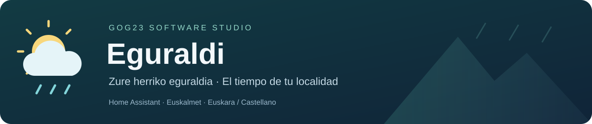
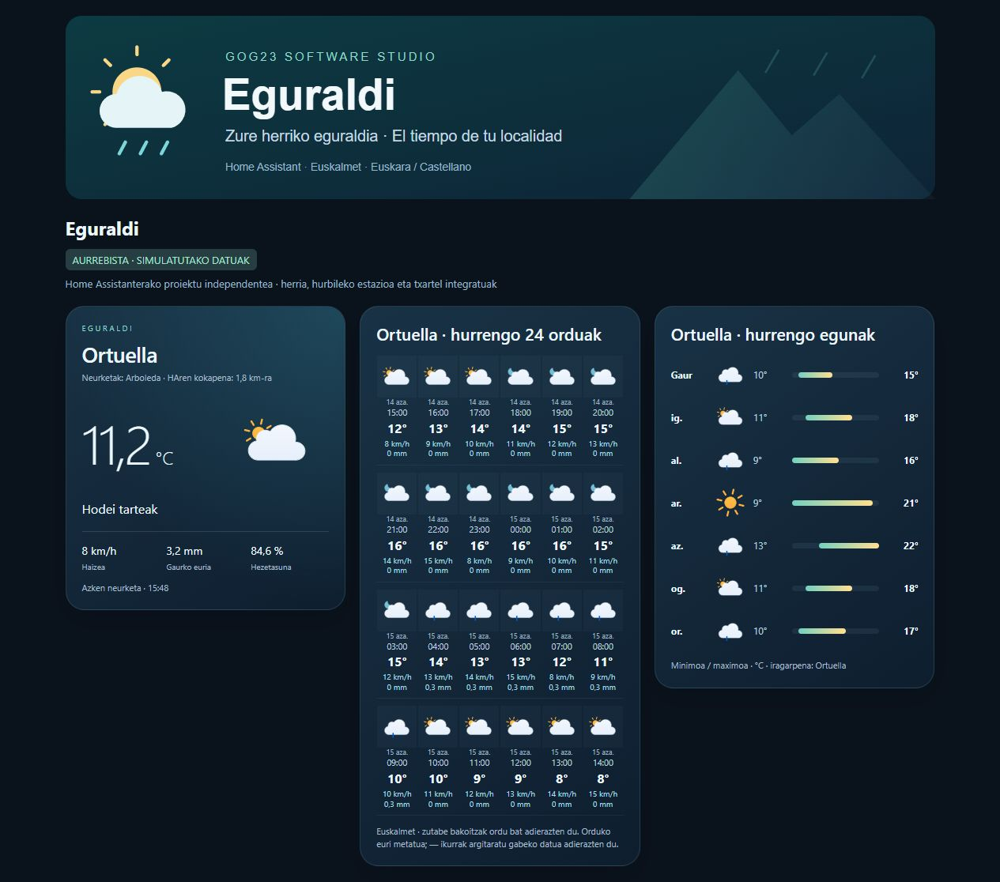

# Eguraldi

**Euskara** · [Leer en castellano](README.md)

[GOG23 Software Studio](https://github.com/GOG23-Software-Studio) proiektua · Mantentzailea: [@oyogor1985](https://github.com/oyogor1985)

Euskalmeteko eguraldia Home Assistanten: hurbileko estazioen neurketak, orduko eta eguneko iragarpenak, abisuak, radarra eta txartel integratuak.

[](https://github.com/GOG23-Software-Studio/eguraldi/actions/workflows/ci.yml)
[](https://github.com/GOG23-Software-Studio/eguraldi/releases)

**0.1.2 bertsioa.** Komunitate-proiektu independentea, Euskalmetekin edo Eusko Jaurlaritzarekin lotura ofizialik gabea.



[Ikusi mugikorreko ikuspegia](docs/preview-mobile.jpg) · [Ikusi editore bisuala](docs/preview-editor.jpg)

## Instalazioa

[**Ireki Eguraldi HACSen**](https://my.home-assistant.io/redirect/hacs_repository/?owner=GOG23-Software-Studio&repository=eguraldi&category=integration)

Estekak ez badu funtzionatzen, gehitu `https://github.com/GOG23-Software-Studio/eguraldi` HACS / Marketplace-n, biltegi pertsonalizatu gisa, **Integrazioa** kategorian.

1. Instalatu Eguraldiren azken bertsioa eta berrabiarazi Home Assistant.
2. Joan **Ezarpenak → Gailuak eta zerbitzuak → Gehitu integrazioa → Eguraldi** atalera.
3. Sartu [Open Data Euskadiko](https://api.euskadi.eus/opendata-apikey/#/) kontuaren helbide elektronikoa eta `privatekey.pem` fitxategiaren eduki osoa.
4. Utzi **Home Assistant-en kokapena** hautatuta, edo aukeratu **Beste herri bat**. Berrikusi udalerria eta estazioa gorde aurretik.
5. Gehitu **Eguraldi** txartela zure panelera. Aukeratu ikuspegia eta kokapena editore bisualean.

Home Assistant **2026.8 edo berriagoa**, Internet eta Open Data Euskadiko doako kontua behar dira. Aktibazio-mezua ez bada iristen, begiratu spam karpeta edo saiatu **Google bidez sartzen**. Laguntzaileak gakoak deskargatzeko esteka du.

Biltegi pertsonalizatuaren bidez instala daiteke. HACS katalogo orokorrerako [eskaera aurkeztuta dago](https://github.com/hacs/default/pull/14144), baina berrikuspena falta da: ez da onartutzat aurkezten.

[Instalazioari, eguneraketei eta arazoei buruzko gida (gaztelaniaz)](docs/INSTALLATION.md)

## Zer eskaintzen du?

- Uneko eguraldia eta eguneko, hileko eta urteko laburpen meteorologikoak.
- Hurrengo 24 orduak: sei orduko lau errenkada, ikono animatuekin eta alboko korritzerik gabe.
- Zazpi eguneko iragarpena, ikonoekin eta tenperatura minimo/maximoen barrekin.
- Kokapenean zentratutako radar animatua, markatzailea, hurbileko zooma, **Nire kokapena** eta **Estaldura ikusi** botoiak.
- Hileko historikoa eta etxeko tenperatura-sentsore batekin konparazioa.
- Abisuak, itsas iragarpena, mareak eta polena.
- Txartel integratuak, Mushroom, button-card edo beste osagarririk gabe.

## Kokapena eta estazioa

Lehenetsitako aukerak HAren kokapena erabiltzen du. Udalerria lokalean identifikatzen da, geoEuskadiko kartografia integratuarekin: **etxeko koordenatuak ez dira geokodetzaile batera bidaltzen**. Estazio automatikoa puntu horretatik hurbilen dagoen estazio bateragarria da. HAren kokapen orokorra aldatuz gero, lotutako sarrera eguneratzen da; eskuz aukeratutako herriek independente jarraitzen dute.

**Konfiguratu** atalean herria edo estazioa alda dezakezu. Irekita dauden txartelen izenburuak, distantziak, laburpenak eta historikoa berriro kargatu gabe eguneratzen dira. Entitateen identifikatzaileak mantentzen dira. Beste herri bat gordetzean estazio automatikoa berrezartzen da.

Beste herri bat gehitzeko, sakatu **Gehitu zerbitzua** eta berrerabili HAn gordetako kontua, gakoa berriro sartu gabe. Gehitu haren txartelak eta hautatu kokapena editore bisualean.

## Hizkuntza

Konfigurazioa eta txartelak **euskaraz eta gaztelaniaz** erabil daitezke. Txartelek Home Assistant-eko profilaren hizkuntza jarraitzen dute, eta hura aldatzean eguneratzen dira. Herrien eta estazioen izenak mantentzen dira; hornitzailearen testu ofizialak jatorrizko hizkuntzan erakusten dira.

## Txartelak

**Gehitu txartela → Eguraldi** atalean, editoreak ikuspegia eta kokapena hautatzeko, radarraren zooma doitzeko eta konparatzeko sentsorea aukeratzeko aukera ematen du. Ez da identifikatzailerik idatzi behar.

YAML ere erabil dezakezu:

```yaml
type: custom:euskalmet-local-card
mode: dashboard
```

| Ikuspegia | `mode` |
| --- | --- |
| Panel osoa | `dashboard` |
| Uneko eguraldia | `overview` |
| Hurrengo 24 orduak | `hourly` |
| Hurrengo egunak | `daily` |
| Gaurko laburpena | `summaries` |
| Hileko historikoa | `history` |
| Radarra | `radar` |
| Abisuak | `alerts` |
| Tenperaturen konparazioa | `comparison` |
| Kostaldea eta ingurumena | `environment` |

Kokapen bakarra badago, automatikoki hautematen da. Hainbat badaude, gorde kokapena editorearen bidez; YAMLen `entry_id` erabil daiteke. Baliabideak automatikoki erregistratzen dira. Instalazioak ez ditu panel pertsonalak sortzen edo aldatzen.

## Datuen esanahia eta mugak

Estazioak bere kokapenean eta altitudean neurtzen du. Tenperatura argitaratzen duten estazio aktiboak hautatzen dira, 120 km baino gutxiagora; beste magnitude batzuk falta daitezke. Hurbiltasunak ez ditu etxeko baldintza berdinak bermatzen.

Iragarpena eta abisuak herriari dagozkio, estazioa aldatu arren. Radarra eskualdekoa da; itsasoak eta mareek Kantauri itsasoko eta Pasaiako erreferentziak erabiltzen dituzte. Polenak erreferentziako neurgailuaren argitaratutako lagina adierazten du.

Txartelak Euskalmeten jatorrizko hezetasuna erakusten du, baita % 100etik gorakoa ere. `raw_value` eta `quality` atributuek neurketa eta kalitatea gordetzen dituzte. HAn gordetako neurketak mantentzen dira estazioa aldatzean; hileko historikoak hautatutako estazioa kontsultatzen du.

Tokiko udalerri-detekzioak integratutako Euskadiko poligonoak hartzen ditu. Estalduratik kanpo, muga zalantzagarrietan edo iragarpen argirik ez dagoenean, eskuz aukeratzeko aukera eskaintzen da.

## Pribatutasuna eta laguntza

Helbide elektronikoa eta gakoa HAn gordetzen dira; Euskalmetera sartzeko eskaerak bertan sinatzen dira. Txartelek eta editoreak ez dute gakoa jasotzen. Eskuzko bilaketak udalerriaren izena soilik bidaltzen dio Open-Meteo / GeoNames zerbitzuari. Mapak Esriren teselak erabiltzen ditu lehenetsitako estilo ilunean, edo OpenStreetMapenak dagozkien estiloetan. Proiektuak ez du telemetriarik.

[Ireki arazo bat](https://github.com/GOG23-Software-Studio/eguraldi/issues/new/choose), bertsioak eta urratsak adieraziz. Ez argitaratu gakorik, helbide elektronikorik edo koordenaturik. [VALIDATION.md](VALIDATION.md) fitxategiak probak eta haien mugak azaltzen ditu (gaztelaniaz).

`euskalmet_local` domeinua mantentzen da aurreko bertsioekin bateragarri izateko. Beste integrazioekin batera instala daiteke eta ez ditu automatikoki desinstalatzen.

## Kredituak eta lizentzia

MIT. Euskalmeteko konexioa eta plataformak [mitxol/home-assistant-euskalmet v2.12.9](https://github.com/mitxol/home-assistant-euskalmet/tree/v2.12.9) proiektuan oinarritzen dira, Copyright 2026 Mitxol. Herrien laguntzailea, estazio-hautaketa eta txartel integratuak GOG23 Software Studioren lana dira.

Datuak: Euskalmet / Open Data Euskadi. Geokodetzea: Open-Meteo / GeoNames. Ikonoak: Meteocons, Bas Milius. Mapak: Esri / OpenStreetMap; Leaflet integratuta. Udalerri-mugak: **Eusko Jaurlaritza / Gobierno Vasco. geoEuskadi.** [Iturria](https://www.geo.euskadi.eus/limites-administrativos-del-pais-vasco/webgeo00-dataset/es/).

[Lizentzia](LICENSE) · [Hirugarrenen oharrak](THIRD_PARTY_NOTICES.md) · [Ekarpenak](CONTRIBUTING.md)

## Proiektua babestu

Eguraldi doakoa eta kode irekikoa da. Erabilgarria bazaizu eta garapenari eskainitako denbora babestu nahi baduzu, [kafe batera gonbida nazakezu](https://www.buymeacoffee.com/oyogor). Laguntza borondatezkoa da eta ez du funtziorik desblokeatzen.

<a href="https://www.buymeacoffee.com/oyogor" target="_blank" rel="noopener noreferrer"></a>
