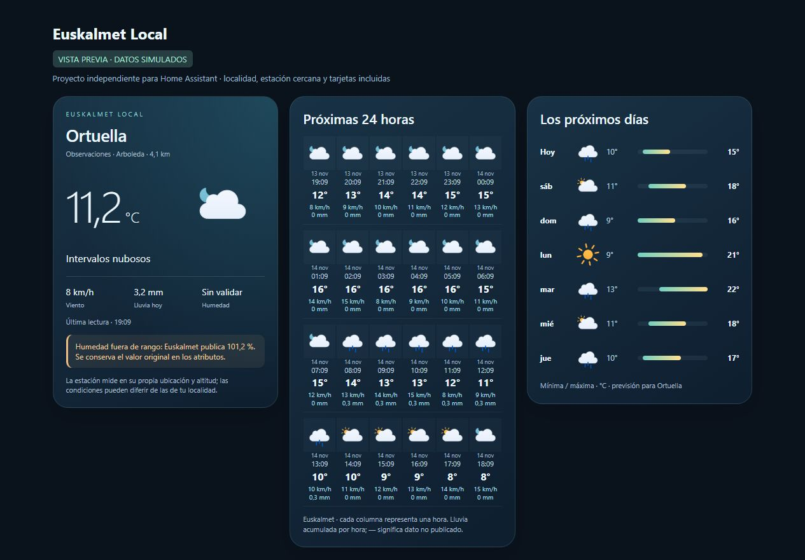

# Eguraldi

Tu localidad primero. Observaciones de una estación cercana, previsión para tu municipio y tarjetas animadas incluidas en una integración de Home Assistant.

**Beta 0.1.0b12. Proyecto comunitario no oficial**, sin afiliación ni soporte de Euskalmet o del Gobierno Vasco. No reemplaza los avisos oficiales de emergencia.



## Qué incluye

- Configuración desde la interfaz: correo y clave privada personal de Open Data Euskadi → localidad → confirmación del municipio → estación recomendada.
- Selección explicable: estaciones meteorológicas activas, temperatura disponible, distancia máxima de 120 km; se elige la más cercana por distancia al municipio. La disponibilidad de humedad y lluvia solo desempata distancias iguales. La cercanía no implica equivalencia climática. La altitud no se puntúa porque no está disponible de forma consistente.
- Posibilidad de elegir otra estación al configurar y desde **Opciones**, o volver a la recomendación automática.
- Previsión y zona de avisos ligadas a la localidad; cambiar de estación solo cambia las observaciones.
- Sensores meteorológicos, resúmenes diarios/mensuales/anuales, polen, mar, mareas, radar e históricos consultados bajo demanda.
- Tarjetas propias sin Mushroom, button-card, clock-weather-card ni stack-in-card: tiempo actual, **24 horas en cuatro filas de seis**, siete días con barras de mínimas/máximas y panel con radar, histórico y avisos.
- Iconos animados Meteocons incluidos localmente, con variantes diurnas/nocturnas según la posición solar aproximada de cada hora.
- La humedad fuera de 0–100 % no se publica como una medida válida. Sus atributos `raw_value` y `quality` conservan y explican el dato original.

## Requisitos

- Home Assistant 2026.8 o posterior. La beta se verifica también mediante CI en HA 2026.11.1.
- Cuenta personal de [Open Data Euskadi](https://api.euskadi.eus/opendata-apikey/#/) y archivo `privatekey.pem`.
- Internet para las APIs de Euskalmet; Open-Meteo/GeoNames se usa únicamente para buscar el nombre del municipio durante la configuración. El mapa de radar utiliza teselas de OpenStreetMap.

## Instalar por HACS / Marketplace

Mientras no forme parte del catálogo general, añade un **repositorio personalizado** de tipo **Integración**:

```text
https://github.com/GOG23-Software-Studio/eguraldi
```

Activa las versiones preliminares si tu HACS no ofrece la beta. Instala **Eguraldi**, reinicia HA y ve a **Ajustes → Dispositivos y servicios → Añadir integración → Eguraldi**.

1. Abre el enlace a Open Data Euskadi incluido en el asistente. Recomendamos **Acceder con Google** (por ejemplo, con Gmail): el correo de activación del registro tradicional puede no llegar. Si la cuenta está pendiente, usa una cuenta de Google que no esté pendiente. Descarga el ZIP y pega el correo y el contenido de `privatekey.pem`.
2. Escribe tu localidad y confirma el municipio correcto.
3. Revisa la estación recomendada, su distancia y las magnitudes disponibles. Puedes cambiarla antes de confirmar.

Si un municipio no tiene una coincidencia inequívoca en el catálogo de previsiones de Euskalmet, el asistente lo indica. No asigna a escondidas la previsión de otro pueblo.

El dominio es `euskalmet_local`, por lo que puede coexistir con `euskalmet`. No migra ni elimina la otra integración, sus entidades o tus paneles.

## Añadir las tarjetas

Los recursos se registran automáticamente. Recarga el navegador después de instalar. En un panel, pulsa **Añadir tarjeta → Eguraldi** y selecciona la vista en el editor visual.

Panel con tiempo actual y pestañas de previsión, radar, histórico y avisos:

```yaml
type: custom:euskalmet-local-card
mode: dashboard
```

Tarjeta compacta de 24 horas:

```yaml
type: custom:euskalmet-local-card
mode: hourly
```

También existen `mode: daily` y `mode: overview`. No hay que escribir nombres de sensores. Con una única localidad se detecta automáticamente; con varias, la tarjeta solicita elegir una. Para fijarla de forma permanente en YAML, añade `entry_id` (ID de la entrada de Eguraldi).

El paquete **incluye las tarjetas**, pero no modifica paneles existentes ni crea una pestaña sin que el usuario la añada. Este diseño permite usarlo en cualquier panel y evita sobrescribir configuraciones personales.

## Cambiar estación

En la entrada de Eguraldi, abre **Opciones**. Selecciona una estación cercana o **Automática** para recalcular la recomendación. La selección automática se fija al aceptar: no salta entre estaciones con cada actualización. Los identificadores de las entidades están ligados a la entrada para conservarlos al cambiar de estación. Los dispositivos antiguos pueden permanecer vacíos en el registro de HA.

## Privacidad y datos

Las credenciales permanecen en la configuración local de HA y el JWT se firma en HA. No hay claves compartidas ni telemetría. El nombre de municipio se envía a Open-Meteo para localizarlo; no se le envían la clave, el correo ni la ubicación de tu casa. La entrada vinculada a HA usa sus coordenadas localmente; las entradas manuales usan las del municipio. Las coordenadas usadas son las del municipio elegido. Las tarjetas obtienen datos a través del servidor HA y nunca reciben la clave privada.

La disponibilidad y calidad de los datos dependen de la fuente. Polen es una muestra semanal; mar es la previsión del Cantábrico y las mareas son la referencia de Pasaia. Una estación cercana puede estar a otra altitud o tener sensores incompletos. La recomendación muestra esas limitaciones.

## Estado de validación

Consulta [VALIDATION.md](VALIDATION.md) para distinguir pruebas automatizadas, vista previa y pruebas pendientes en un HA real. Esta beta no se debe anunciar como certificada, aprobada por HACS o probada en todas las instalaciones.

## Créditos y licencia

MIT. La conexión a Euskalmet y las plataformas parten de [mitxol/home-assistant-euskalmet v2.12.9](https://github.com/mitxol/home-assistant-euskalmet/tree/v2.12.9), Copyright 2026 Mitxol. No es una creación desde cero ni un proyecto oficial. El asistente por localidad, la selección y las tarjetas integradas son trabajo de GOG23 Software Studio. Véase [THIRD_PARTY_NOTICES.md](THIRD_PARTY_NOTICES.md).

Datos: Euskalmet / Open Data Euskadi. Geocodificación: Open-Meteo / GeoNames. Iconos: Meteocons, Bas Milius (MIT). Mapa: OpenStreetMap; Leaflet y su licencia van incluidos.


### Tarjetas que siguen la localidad y su estación

Los modos `summaries`, `history`, `radar`, `alerts`, `comparison` y `environment` usan el mismo catálogo de la entrada. El encabezado mantiene la localidad. Al guardar otra estación se actualizan la fuente, la distancia, los resúmenes y el histórico abierto sin recargar el panel. El histórico conserva el mes elegido y descarta respuestas pendientes de la estación anterior.

```yaml
type: custom:euskalmet-local-card
mode: history
```

Para comparar las observaciones de la estación con otro sensor:

```yaml
type: custom:euskalmet-local-card
mode: comparison
comparison_entity: sensor.temperatura_balcon
comparison_name: Balcón
```

Con varias localidades, fija `entry_id` o elígela en la tarjeta. El radar es regional; los avisos y la previsión siguen la localidad. Mar, mareas y polen conservan sus fuentes de referencia, señaladas en la tarjeta. El gráfico de últimas 24 horas conserva las lecturas registradas en HA; el histórico mensual consulta la estación seleccionada.


### Cambiar de localidad sin rehacer el panel

En **Configurar → Cambiar localidad**, escribe el municipio, confirma la coincidencia correcta y revisa la nueva estación antes de guardar. La misma entrada adopta la localidad nueva, su previsión y zona de avisos, y la estación compatible más cercana. Las tarjetas abiertas se actualizan automáticamente y conservan los IDs de entidades. Las lecturas ya registradas en HA se conservan.

Desde **Configurar → Cambiar estación** puedes seleccionar otra manualmente o volver a **Automática · más cercana a tu localidad**. Al guardar otra localidad se restablece la selección automática. Si la localidad está duplicada o no tiene previsión o estaciones compatibles, la configuración anterior permanece intacta.


### Ubicación de Home Assistant y otras localidades

La opción predeterminada al configurar es **Ubicación de Home Assistant**. El municipio se identifica localmente con los límites de geoEuskadi. La estación se elige por distancia a la ubicación de HA, no al centro del municipio. Las coordenadas de casa no se envían a servicios de geocodificación. Si cambias la ubicación de HA, esta entrada se actualiza; las entradas manuales permanecen independientes.

Para añadir otra localidad, pulsa **Añadir servicio**, reutiliza la cuenta que ya está guardada en HA y elige **Otra localidad**. Las claves se reutilizan únicamente dentro de HA y nunca se envían al navegador. Cada localidad dispone de sus propias tarjetas y selección de estación. También puedes convertir una entrada desde **Configurar → Usar ubicación de Home Assistant**.

Identificación de municipios limitada a los polígonos de Euskadi incluidos; fuera de cobertura o en un límite ambiguo se ofrece la selección manual. Fuente cartográfica: **Eusko Jaurlaritza / Gobierno Vasco. geoEuskadi.** [Límites administrativos](https://www.geo.euskadi.eus/limites-administrativos-del-pais-vasco/webgeo00-dataset/es/), descargados el 13 de noviembre de 2026. Se distribuyen en su formato comprimido sin enviar ninguna ubicación personal al proveedor.
