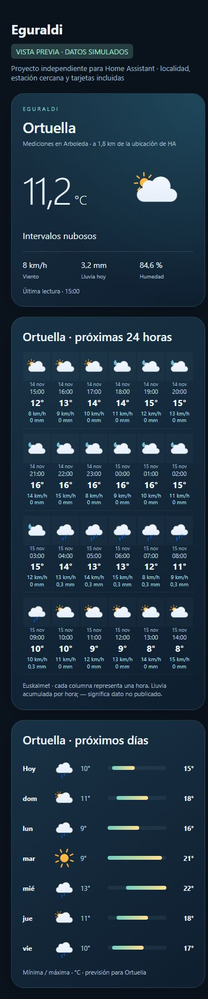
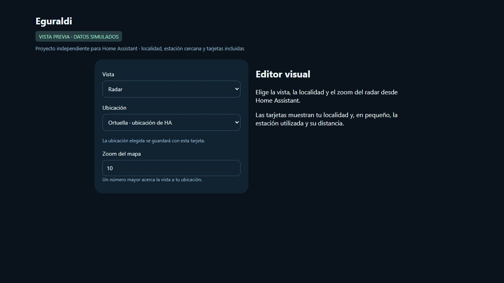

# Eguraldi

El tiempo de Euskalmet en Home Assistant: observaciones de estaciones cercanas, previsión por horas y días, avisos, radar y tarjetas incluidas.

[](https://github.com/GOG23-Software-Studio/eguraldi/actions/workflows/ci.yml)

[](https://github.com/GOG23-Software-Studio/eguraldi/releases)

**Versión 0.1.1.** Proyecto comunitario independiente, sin afiliación con Euskalmet ni con el Gobierno Vasco.


<details>

<summary>Ver la vista móvil y el editor visual</summary>





</details>

## Instalar

[**Abrir Eguraldi en HACS**](https://my.home-assistant.io/redirect/hacs_repository/?owner=GOG23-Software-Studio&repository=eguraldi&category=integration)

Si el enlace no funciona, añade este repositorio en **HACS / Marketplace**, como **Integración**:

```text

https://github.com/GOG23-Software-Studio/eguraldi

```

1. Instala la última versión de **Eguraldi** y reinicia Home Assistant.

2. Ve a **Ajustes → Dispositivos y servicios → Añadir integración → Eguraldi**.

3. Introduce el correo de tu cuenta de [Open Data Euskadi](https://api.euskadi.eus/opendata-apikey/#/) y el contenido completo de `privatekey.pem`.

4. Deja seleccionada **Ubicación de Home Assistant**, o elige **Otra localidad**. Revisa el municipio y la estación antes de guardar.

5. Añade una tarjeta **Eguraldi** a tu panel. Elige la vista y la ubicación en el editor visual.

Necesitas **Home Assistant 2026.8 o posterior**, Internet y una cuenta gratuita de Open Data Euskadi. Si no llega el correo de activación, revisa spam o prueba **Iniciar sesión con Google**. El asistente incluye el enlace para descargar tus claves.

La instalación por repositorio personalizado ya está disponible. La inclusión en el catálogo general requiere revisión externa; Eguraldi no se anuncia como aprobado por HACS.

[Guía de instalación, actualización y solución de problemas](docs/INSTALLATION.md)

## Qué incluye

- Tiempo actual y resúmenes meteorológicos diarios, mensuales y anuales.

- Próximas 24 horas en cuatro filas de seis, con iconos animados y sin desplazamiento horizontal.

- Previsión de siete días con iconos y barras de mínimas y máximas.

- Radar animado centrado en la ubicación, marcador, zoom cercano, **Mi ubicación** y **Ver cobertura**.

- Histórico mensual y comparación de temperaturas con un sensor de tu casa.

- Avisos, previsión marítima, mareas y polen.

- Tarjetas incluidas sin Mushroom, button-card ni otros complementos.

## Ubicación y estación

La opción predeterminada usa la ubicación de HA. El municipio se identifica localmente con cartografía incluida de geoEuskadi: **no se envían las coordenadas de casa a un geocodificador**. La estación automática es la compatible más cercana a ese punto. Si cambias la ubicación global de HA, la entrada vinculada se actualiza; las localidades manuales permanecen independientes.

Desde **Configurar** puedes cambiar de localidad o estación. Los títulos, distancias, resúmenes e histórico de las tarjetas abiertas se actualizan sin recargar. Los identificadores de entidades se conservan. Al guardar otra localidad se restablece la estación automática.

Para añadir otra localidad, pulsa **Añadir servicio** y reutiliza la cuenta guardada en HA, sin introducir de nuevo la clave. Añade sus tarjetas y selecciona esa ubicación en el editor visual.

## Tarjetas

En **Añadir tarjeta → Eguraldi**, el editor permite elegir vista y ubicación, ajustar el zoom del radar y seleccionar un sensor para comparar. No hace falta escribir identificadores.

También puedes usar YAML:

```yaml

type: custom:euskalmet-local-card

mode: dashboard

```

| Vista | `mode` |

| --- | --- |

| Panel completo | `dashboard` |

| Tiempo actual | `overview` |

| Próximas 24 horas | `hourly` |

| Próximos días | `daily` |

| Resumen de hoy | `summaries` |

| Histórico mensual | `history` |

| Radar | `radar` |

| Avisos | `alerts` |

| Comparación de temperatura | `comparison` |

| Costa y ambiente | `environment` |

Con una sola ubicación se detecta automáticamente. Con varias, guarda la ubicación desde el editor; en YAML se puede fijar con `entry_id`. Los recursos se registran automáticamente. La instalación no modifica ni crea paneles personales.

## Qué representan los datos

La estación mide en su propia ubicación y altitud. Se eligen estaciones meteorológicas activas con temperatura disponible y a menos de 120 km; otras magnitudes pueden faltar. La cercanía no garantiza condiciones idénticas a las de casa.

La previsión y los avisos corresponden a la localidad, aunque cambies de estación. El radar es regional; mar y mareas usan sus referencias del Cantábrico y Pasaia. El polen corresponde a una captadora de referencia y su muestra publicada.

La tarjeta muestra la humedad original de Euskalmet, incluso por encima del 100 %. Los atributos `raw_value` y `quality` conservan lectura y calidad. Las lecturas registradas en HA se mantienen al cambiar de estación; el histórico mensual consulta la estación seleccionada.

La detección local de municipios cubre los polígonos de Euskadi incluidos. Fuera de cobertura, en límites ambiguos o sin previsión inequívoca, se ofrece la elección manual.

## Privacidad y ayuda

El correo y la clave permanecen en HA; el acceso a Euskalmet se firma allí. Las tarjetas y el editor no reciben la clave. La búsqueda manual envía solo el nombre del municipio a Open-Meteo / GeoNames. El mapa obtiene teselas de Esri en el estilo oscuro predeterminado, u OpenStreetMap en sus estilos correspondientes. No hay telemetría del proyecto.

[Abre una incidencia](https://github.com/GOG23-Software-Studio/eguraldi/issues/new/choose) indicando versiones y pasos. No publiques claves, correo ni coordenadas. Consulta [VALIDATION.md](VALIDATION.md) para conocer las pruebas y sus límites.

El dominio `euskalmet_local` se mantiene por compatibilidad con las betas. Puede coexistir con otras integraciones y no las desinstala automáticamente.

## Créditos y licencia

MIT. La conexión a Euskalmet y las plataformas parten de [mitxol/home-assistant-euskalmet v2.12.9](https://github.com/mitxol/home-assistant-euskalmet/tree/v2.12.9), Copyright 2026 Mitxol. El asistente por localidad, selección y tarjetas integradas son trabajo de GOG23 Software Studio.

Datos: Euskalmet / Open Data Euskadi. Geocodificación: Open-Meteo / GeoNames. Iconos: Meteocons, Bas Milius. Mapas: Esri / OpenStreetMap; Leaflet incluido. Límites municipales: **Eusko Jaurlaritza / Gobierno Vasco. geoEuskadi.** [Fuente](https://www.geo.euskadi.eus/limites-administrativos-del-pais-vasco/webgeo00-dataset/es/).

[Licencia](LICENSE) · [Avisos de terceros](THIRD_PARTY_NOTICES.md) · [Contribuir](CONTRIBUTING.md)

## Apoyar el proyecto

Eguraldi es gratuito y de código abierto. Si te resulta útil y quieres apoyar el tiempo que dedico a desarrollarlo, puedes [invitarme a un café](https://www.buymeacoffee.com/oyogor). El apoyo es opcional y no desbloquea funciones.

<a href="https://www.buymeacoffee.com/oyogor" target="_blank" rel="noopener noreferrer"></a>
