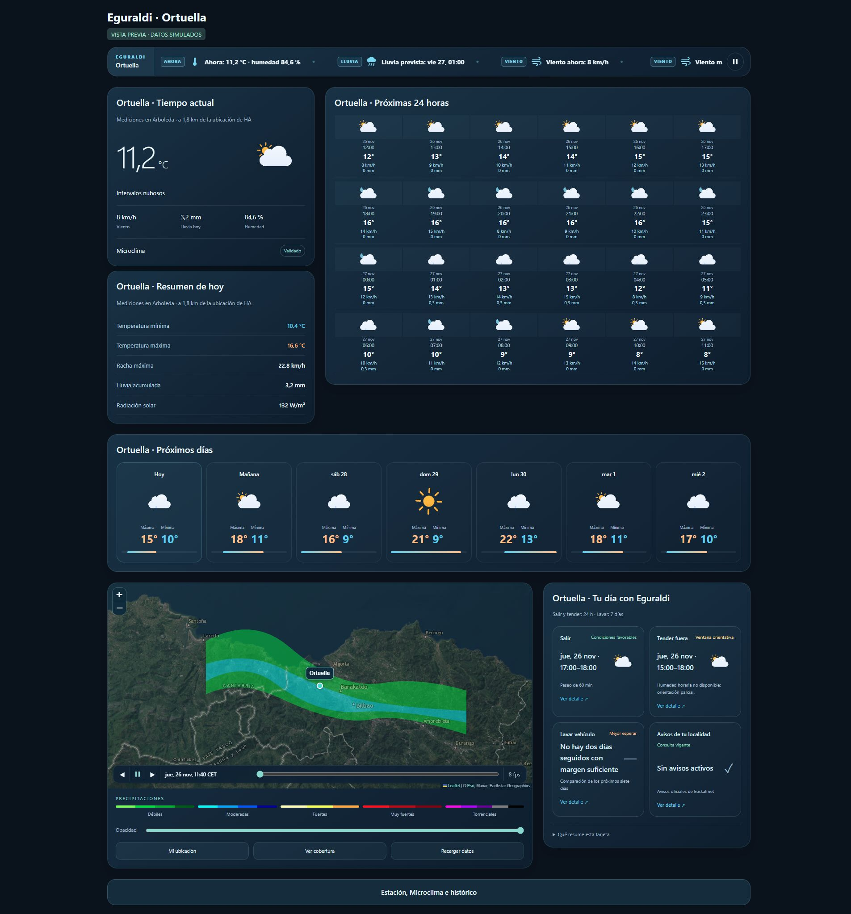
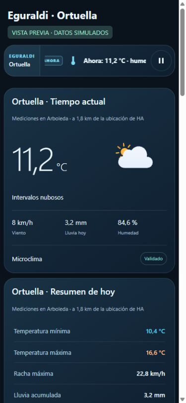
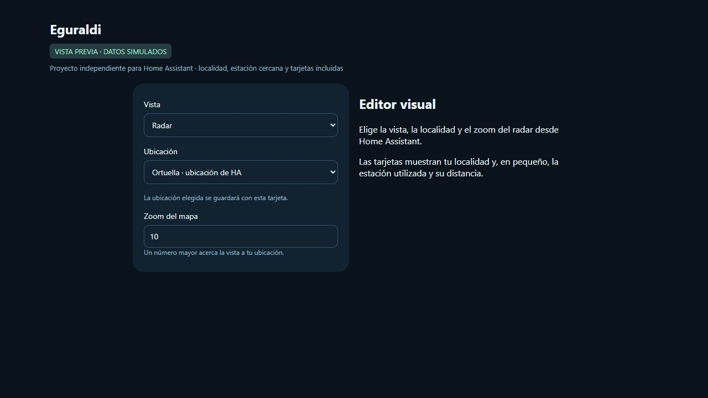
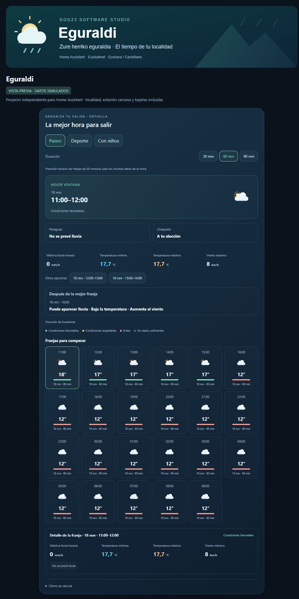
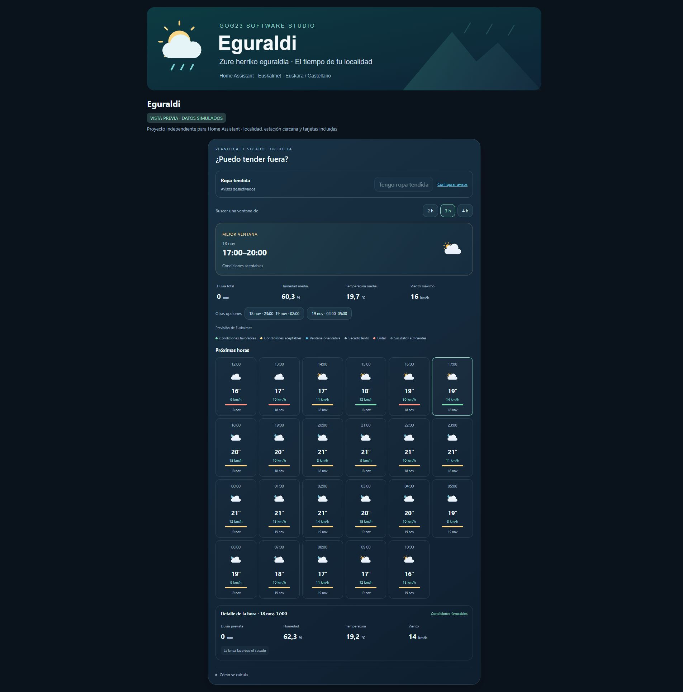
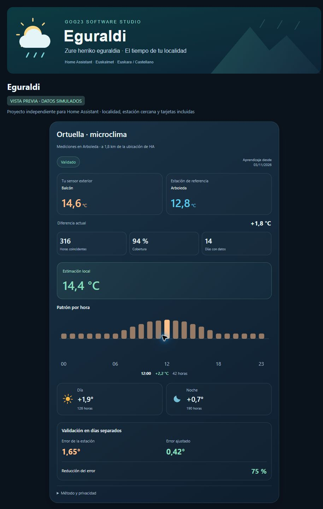
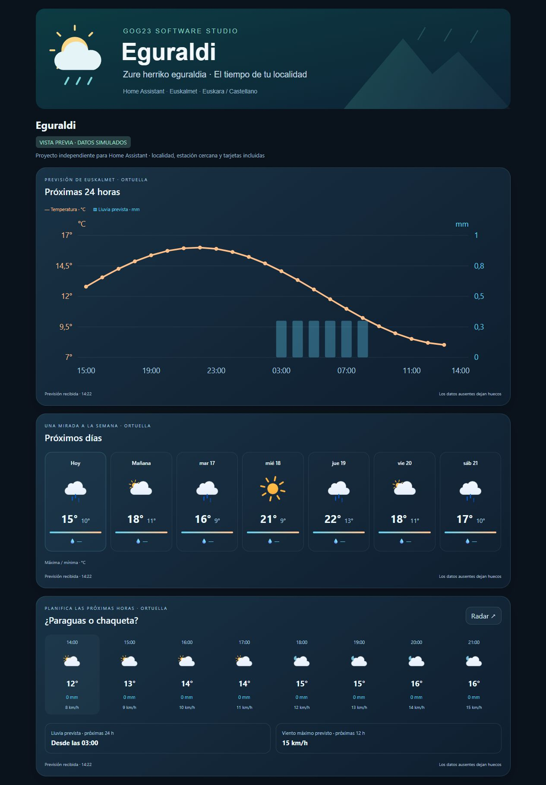
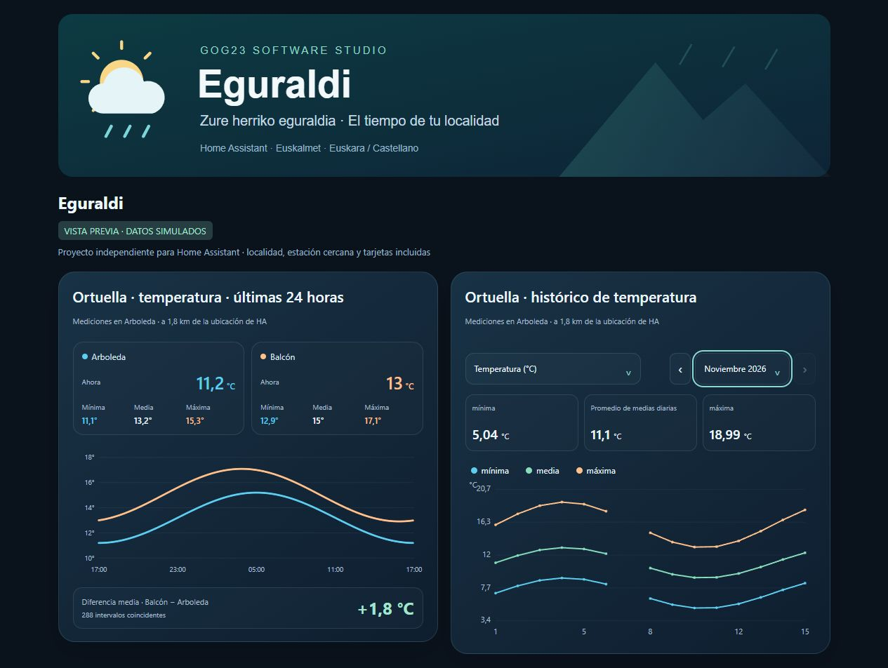
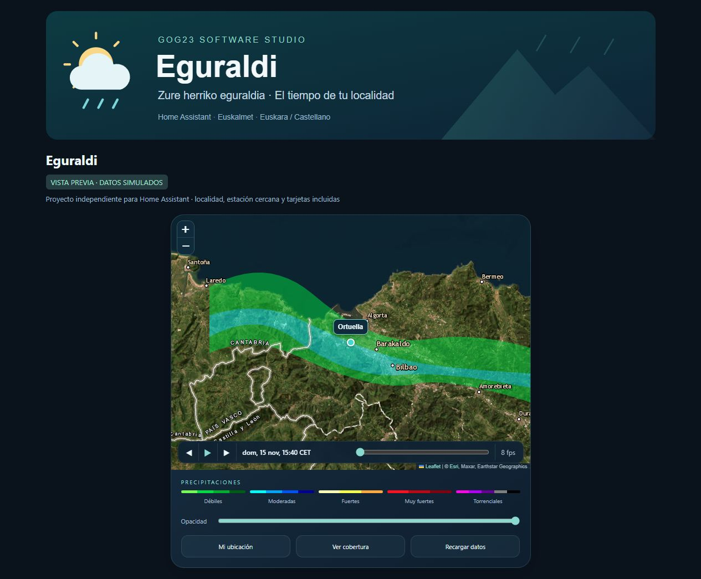
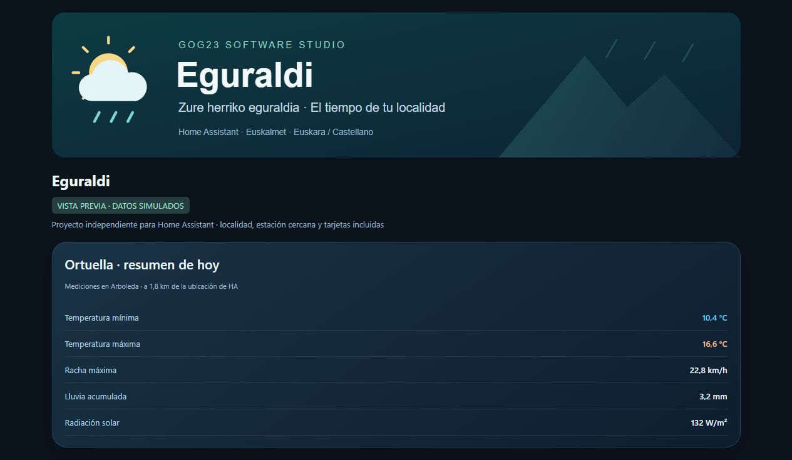

# Eguraldi

**Castellano** · [Euskaraz irakurri](README.eu.md)

Un proyecto de [GOG23 Software Studio](https://github.com/GOG23-Software-Studio) · Mantenido por [@oyogor1985](https://github.com/oyogor1985)

El tiempo de Euskalmet en Home Assistant: observaciones de estaciones cercanas, previsión por horas y días, avisos, radar y tarjetas incluidas.

[](https://github.com/GOG23-Software-Studio/eguraldi/actions/workflows/ci.yml)

[](https://github.com/GOG23-Software-Studio/eguraldi/releases)

**Versión 0.4.0.** Proyecto comunitario independiente, sin afiliación con Euskalmet ni con el Gobierno Vasco.



<details>

<summary>Ver la vista móvil y el editor visual</summary>





</details>

## La mejor hora para salir

Elige **Paseo**, **Deporte** o **Con niños**, y una duración de **30, 60 o 90 minutos**. La tarjeta busca una franja favorable en las próximas 24 horas, propone hasta dos alternativas, orienta sobre paraguas y chaqueta e indica el primer empeoramiento posterior de lluvia, temperatura o viento, dentro de las seis horas siguientes con datos.

La previsión es horaria: las salidas a media hora reutilizan esos bloques, sin inventar una predicción de 30 minutos. Todas las horas atravesadas deben tener datos; las condiciones adversas y los huecos impiden recomendar una franja. No necesita Microclima ni otros proveedores. [Reglas y configuración](docs/OUTING.md).



[Vista móvil](docs/outing-mobile.jpg). Disponible en el editor como **La mejor hora para salir** (`mode: outing`) y en la pestaña **Salir** del panel completo.

## ¿Puedo tender fuera?

La vista **Tender fuera** (`mode: drying`) busca la mejor ventana de 2, 3 o 4 horas completas de las próximas 24 horas y ofrece alternativas. Compara lluvia, temperatura, humedad y viento; toca una hora para ver sus datos y los motivos. El editor permite añadir una previsión horaria de la misma localidad como **complemento de humedad**: solo se usa esa variable y se indica su origen.

La previsión que publica actualmente Eguraldi no incluye humedad horaria. Sin un complemento, la tarjeta ofrece una ventana orientativa y deja la humedad sin datos; no usa la humedad actual como si fuera una previsión. No necesita Microclima ni sensores propios. [Configuración y reglas](docs/DRYING.md).



[Vista móvil](docs/drying-mobile.jpg). Las recomendaciones son orientativas; la duración elegida es la ventana que buscas, no una promesa de tiempo de secado.

## Microclima de tu casa

Eguraldi añade aprendizaje local con un sensor exterior propio: diferencias por hora y día/noche, cobertura de datos y validación en días separados. La estimación se activa solo si demuestra una mejora respecto a la estación. **No es una corrección de la previsión oficial.**

Actívalo en **Ajustes → Dispositivos y servicios → Eguraldi → Configurar → Microclima de tu casa**. Elige un sensor exterior protegido del sol directo. Aparece en el bloque desplegable de tiempo actual y como vista **Microclima** en el editor de tarjetas.

El aprendizaje empieza al activarlo: necesita al menos cinco días con datos para aprender y otros dos días completos para comprobar el resultado. Cambiar de sensor, estación o localidad reinicia el periodo. Todo se procesa dentro de HA, sin nuevas consultas a Euskalmet. [Método, requisitos y límites](docs/MICROCLIMATE.md).

El gráfico compara tu sensor, la estación y el ajuste local en los dos días reservados para validación. Muestra el error antes y después, la mejora de cada día y las condiciones para activar la estimación. Las barras de progreso separan horas, días de aprendizaje y días de validación; los días con poca cobertura no cuentan.



[Vista móvil](docs/microclimate-mobile.jpg) · [Estado de aprendizaje](docs/microclimate-learning.jpg). Capturas de demostración con datos simulados; el estado «Validado» ilustra el resultado tras superar los requisitos, no el estado inicial.

## Instalar

[**Abrir Eguraldi en HACS**](https://my.home-assistant.io/redirect/hacs_repository/?owner=GOG23-Software-Studio&repository=eguraldi&category=integration)

Si el enlace no funciona, añade este repositorio en **HACS / Marketplace**, como **Integración**:

```text
https://github.com/GOG23-Software-Studio/eguraldi

```

1. Instala la última versión de **Eguraldi** y reinicia Home Assistant.

2. Ve a **Ajustes → Dispositivos y servicios → Añadir integración → Eguraldi**.

3. Introduce el correo de tu cuenta de [Open Data Euskadi](https://api.euskadi.eus/opendata-apikey/#/) y el contenido completo de `privatekey.pem`.

4. Deja seleccionada **Ubicación de Home Assistant**, o elige **Otra localidad**. Revisa el municipio y la estación antes de guardar.

5. Añade una tarjeta **Eguraldi** a tu panel. Elige la vista y la ubicación en el editor visual.

Necesitas **Home Assistant 2026.8 o posterior**, Internet y una cuenta gratuita de Open Data Euskadi. Si no llega el correo de activación, revisa spam o prueba **Iniciar sesión con Google**. El asistente incluye el enlace para descargar tus claves.

Eguraldi se instala como **repositorio personalizado de HACS**. La [solicitud de inclusión en el catálogo general](https://github.com/hacs/default/pull/14144) se cerró el 17 de noviembre de 2026, sin aprobación, por su similitud con la integración Euskalmet original, que sigue activa. Esto no afecta a la instalación ni a las actualizaciones desde este repositorio personalizado.

[Guía de instalación, actualización y solución de problemas](docs/INSTALLATION.md)

## Qué incluye

- Tiempo actual y resúmenes meteorológicos diarios, mensuales y anuales.

- Próximas 24 horas en cuatro filas de seis, con iconos animados y sin desplazamiento horizontal.

- Previsión de siete días con iconos y barras de mínimas y máximas.

- Radar animado centrado en la ubicación, marcador, zoom cercano, **Mi ubicación** y **Ver cobertura**.

- Histórico mensual y comparación de temperaturas con un sensor de tu casa.

- Avisos, previsión marítima, mareas y polen.

- Tarjetas incluidas sin Mushroom, button-card ni otros complementos.

## Ubicación y estación

La opción predeterminada usa la ubicación de HA. El municipio se identifica localmente con cartografía incluida de geoEuskadi: **no se envían las coordenadas de casa a un geocodificador**. La estación automática es la compatible más cercana a ese punto. Si cambias la ubicación global de HA, la entrada vinculada se actualiza; las localidades manuales permanecen independientes.

Desde **Configurar** puedes cambiar de localidad o estación. Los títulos, distancias, resúmenes e histórico de las tarjetas abiertas se actualizan sin recargar. Los identificadores de entidades se conservan. Al guardar otra localidad se restablece la estación automática.

Para añadir otra localidad, pulsa **Añadir servicio** y reutiliza la cuenta guardada en HA, sin introducir de nuevo la clave. Añade sus tarjetas y selecciona esa ubicación en el editor visual.

## Idioma

La configuración y las tarjetas están disponibles en **castellano y euskera**. Las tarjetas siguen el idioma del perfil de Home Assistant y se actualizan al cambiarlo. Los nombres de localidades y estaciones se conservan; los textos oficiales del proveedor mantienen su idioma de origen.

## Tarjetas

En **Añadir tarjeta → Eguraldi**, el editor permite elegir vista y ubicación, ajustar el zoom del radar y seleccionar un sensor para comparar. No hace falta escribir identificadores.

También puedes usar YAML:

```yaml
type: custom:euskalmet-local-card
mode: dashboard

```
| Vista | `mode` |
| --- | --- |
| Panel completo | `dashboard` |
| Tiempo actual | `overview` |
| Próximas 24 horas | `hourly` |
| Próximos días | `daily` |
| Gráfico de temperatura y lluvia · 24 h | `hourly_chart` |
| Semana visual con máximas y mínimas | `daily_tiles` |
| Planifica las próximas horas | `planning` |
| Resumen de hoy | `summaries` |
| Microclima | `microclimate` |
| Tender fuera | `drying` |
| La mejor hora para salir | `outing` |
| Histórico mensual | `history` |
| Radar | `radar` |
| Avisos | `alerts` |
| Comparación de temperatura | `comparison` |
| Costa y ambiente | `environment` |

Con una sola ubicación se detecta automáticamente. Con varias, guarda la ubicación desde el editor; en YAML se puede fijar con `entry_id`. Los recursos se registran automáticamente. La instalación no modifica ni crea paneles personales.



El gráfico separa temperatura y lluvia horaria (mm). La semana visual muestra lluvia solo si el proveedor la publica. El planificador distingue la racha máxima del viento máximo previsto y ofrece un radar desplegable. El radar usa mapa satélite por defecto, sin título superior; puedes elegir otro mapa en el editor. Los avisos mantienen una sola cabecera.



El histórico incluye menús propios de medida y mes/año, con contraste oscuro, navegación por teclado y fechas en castellano o euskera.





El radar comparte el fondo y los controles de las demás tarjetas. Las barras diarias representan la mínima y la máxima sobre una escala común de la semana. Las capturas usan datos de demostración y la ubicación pública de la localidad.

La comparación utiliza estadísticas de HA en intervalos completos de cinco minutos: mínimas, máximas y medias de cada serie, y diferencia media solo en intervalos coincidentes. Las dos series usan la misma unidad. El histórico mensual muestra resúmenes diarios oficiales, con huecos en los días sin datos y sin extender el gráfico a los días futuros del mes actual.

## Qué representan los datos

La estación mide en su propia ubicación y altitud. Se eligen estaciones meteorológicas activas con temperatura disponible y a menos de 120 km; otras magnitudes pueden faltar. La cercanía no garantiza condiciones idénticas a las de casa.

La previsión y los avisos corresponden a la localidad, aunque cambies de estación. El radar es regional; mar y mareas usan sus referencias del Cantábrico y Pasaia. El polen corresponde a una captadora de referencia y su muestra publicada.

La tarjeta muestra la humedad original de Euskalmet, incluso por encima del 100 %. Los atributos `raw_value` y `quality` conservan lectura y calidad. Las lecturas registradas en HA se mantienen al cambiar de estación; el histórico mensual consulta la estación seleccionada.

La detección local de municipios cubre los polígonos de Euskadi incluidos. Fuera de cobertura, en límites ambiguos o sin previsión inequívoca, se ofrece la elección manual.

## Privacidad y ayuda

El correo y la clave permanecen en HA; el acceso a Euskalmet se firma allí. Las tarjetas y el editor no reciben la clave. La búsqueda manual envía solo el nombre del municipio a Open-Meteo / GeoNames. El mapa obtiene teselas de Esri en el estilo oscuro predeterminado, u OpenStreetMap en sus estilos correspondientes. No hay telemetría del proyecto.

[Abre una incidencia](https://github.com/GOG23-Software-Studio/eguraldi/issues/new/choose) indicando versiones y pasos. No publiques claves, correo ni coordenadas. Consulta [VALIDATION.md](VALIDATION.md) para conocer las pruebas y sus límites.

El dominio `euskalmet_local` se mantiene por compatibilidad con las betas. Puede coexistir con otras integraciones y no las desinstala automáticamente.

## Créditos y licencia

MIT. La conexión a Euskalmet y las plataformas parten de [mitxol/home-assistant-euskalmet v2.12.9](https://github.com/mitxol/home-assistant-euskalmet/tree/v2.12.9), Copyright 2026 Mitxol. El asistente por localidad, selección y tarjetas integradas son trabajo de GOG23 Software Studio.

Datos: Euskalmet / Open Data Euskadi. Geocodificación: Open-Meteo / GeoNames. Iconos: Meteocons, Bas Milius. Mapas: Esri / OpenStreetMap; Leaflet incluido. Límites municipales: **Eusko Jaurlaritza / Gobierno Vasco. geoEuskadi.** [Fuente](https://www.geo.euskadi.eus/limites-administrativos-del-pais-vasco/webgeo00-dataset/es/).

[Licencia](LICENSE) · [Avisos de terceros](THIRD_PARTY_NOTICES.md) · [Contribuir](CONTRIBUTING.md)

## Apoyar el proyecto

Eguraldi es gratuito y de código abierto. Si te resulta útil y quieres apoyar el tiempo que dedico a desarrollarlo, puedes [invitarme a un café](https://www.buymeacoffee.com/oyogor). El apoyo es opcional y no desbloquea funciones.

<a href="https://www.buymeacoffee.com/oyogor" target="_blank" rel="noopener noreferrer"></a>
