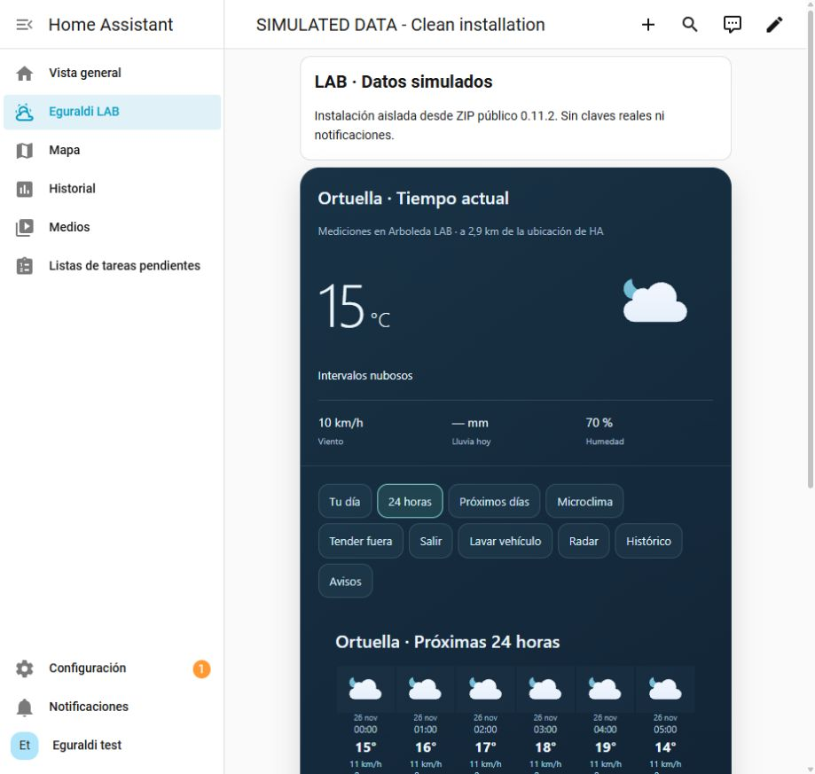

# Instalación limpia en laboratorio · 0.11.2

Ensayo del mantenedor, 25 de noviembre de 2026. **No es una prueba de un usuario independiente, ni una instalación con credenciales reales en otra vivienda.** Amplía la evidencia de instalación y funcionamiento dentro de HA real.

## Entorno y alcance

- Configuración vacía y usuario efímero nuevos; sin copiar `.storage`, paneles, sensores ni claves del HA doméstico.
- Imagen oficial `ghcr.io/home-assistant/home-assistant:2026.11.1`, ejecutada en un contenedor Linux de Docker Desktop para laboratorio. No representa una plataforma de producción soportada ni un ensayo de HA OS.
- Imagen fijada por digest `sha256:6785d1eca68747a524c156faae1b139ed415c07357386ae6fe17291986e59e82`.
- ZIP público de [0.11.2](https://github.com/GOG23-Software-Studio/eguraldi/releases/tag/v0.11.2), verificado contra su SHA-256 publicado. Instalación **manual**, no una nueva descarga desde HACS.
- HA servido solo en `127.0.0.1:18123`, sin red de host ni dispositivos del hogar.
- [Proveedor de laboratorio y reproducción](../tools/lab_provider/README.md): respuestas simuladas en el límite de métodos API. Archivos de Eguraldi sin modificar; sin credenciales reales ni envío de avisos.

## Comprobaciones

| Recorrido | Resultado observado |
| --- | --- |
| Carga inicial del paquete original | HA encuentra la integración y muestra el formulario de credenciales. |
| Clave con formato inválido | El formulario devuelve `invalid_private_key`. No se considera una prueba de autenticación real. |
| Configuración con proveedor simulado | El flujo normal llega a selección de ubicación, propuesta de estación y creación de entrada. |
| Ubicación de HA | La cartografía incluida identifica Ortuella con coordenadas públicas; propone Arboleda LAB a 2,9 km. |
| Entrada cargada | Estado `loaded`, entidad `weather.ortuella`, cinco dispositivos y 49 entidades inicialmente. Algunas entidades opcionales carecen de datos por diseño de la simulación. |
| Panel nuevo | Cargan las tarjetas incluidas sin añadir manualmente recursos JavaScript ni instalar tarjetas de terceros. |
| Estación manual | La UI permite elegir Other station LAB; el panel mantiene Ortuella y muestra 4,3 km y 17 °C simulados. |
| Vuelta a automática | Con el panel abierto, cambia a Arboleda LAB, 2,9 km y 15 °C sin recargar la página. |
| Funciones sin configurar | Microclima propone elegir sensor; los avisos de ropa están desactivados y el botón de sesión está deshabilitado. |
| Configurar avisos desde tarjeta | Abre el formulario local con activación desmarcada y destino sin seleccionar. Se cancela sin guardar ni enviar mensajes. |
| Recomendaciones | Cargan tender, salir y lavado. La falta de humedad horaria se indica como orientación parcial; no se inventa un porcentaje. |
| Datos opcionales vacíos | Los avisos no se anuncian como seguros: se muestra que no pueden comprobarse. No se valida el contenido del radar ni históricos con esta simulación. |
| Editor propio | Ofrece vistas, ubicación y cuatro diseños de alertas; guarda la selección de titulares y HA confirma el guardado. |
| Reinicio del laboratorio | Se comprueba recuperación de la misma entrada y entidad, con estación automática conservada. |

## Hallazgos y límites

HA 2026.11.1 avisa del uso heredado de `via_device` al crear dispositivos: recomienda `via_device_id` y anuncia retirada para HA 2027.8. Es trabajo de mantenimiento pendiente; en la versión ensayada la entrada carga. Cambiar de estación deja dispositivos anteriores sin entidades en el registro; no se ha aplicado una limpieza automática ni se han borrado registros del usuario.

Durante la construcción del laboratorio, la primera carga del proveedor simulado desde YAML se aplicó demasiado tarde al restaurar entradas. Se sustituyó por un bootstrap previo a HA y se repitió el reinicio. Ese fallo del montaje no se atribuye al paquete publicado. En la primera demostración la temperatura diaria quedó vacía por un campo incorrecto de la fixture; se corrigió a `temperatureRange`. Tampoco se considera un fallo del producto.

No se han validado aquí autenticación real, tráfico/formatos reales de la API, instalación limpia mediante HACS, funcionamiento durante varios días, precisión de Microclima, dispositivos de notificación externos, todos los navegadores ni todos los escenarios de fallo. El HA doméstico aporta evidencia distinta de uso real, pero no convierte este ensayo simulado en una prueba independiente. Los resultados de CI siguen documentados en [HACS_EVIDENCE.md](HACS_EVIDENCE.md).

El laboratorio se detiene al finalizar. Sus credenciales efímeras y configuración permanecen fuera de Git en `private/`; solo se publica documentación, fixture y captura con datos simulados.
