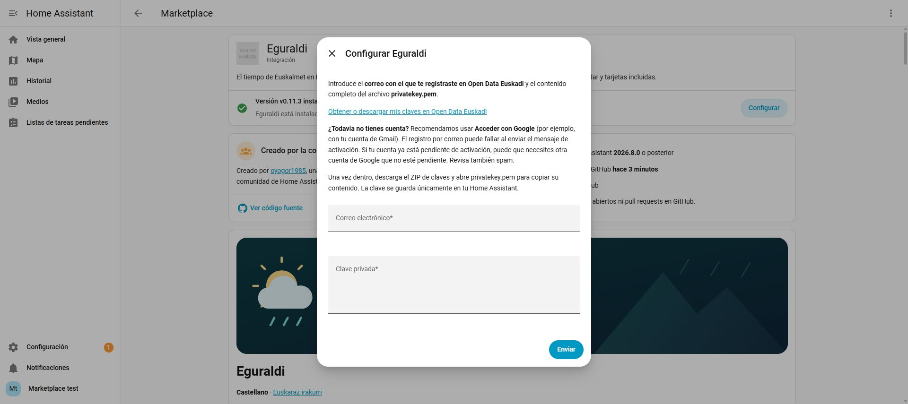
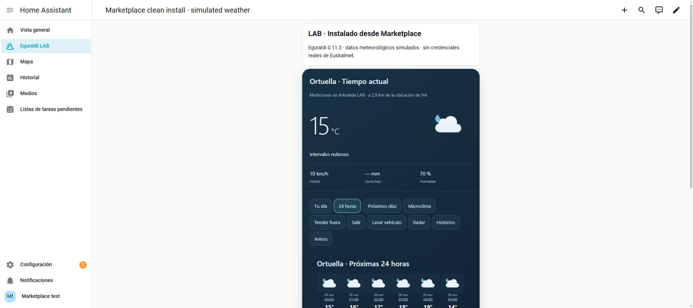

# Instalación limpia desde Marketplace · 0.11.3

Ensayo del mantenedor, 25 de noviembre de 2026, separado del HA doméstico y del laboratorio de instalación manual. La descarga e instalación se han realizado desde la **UI del Marketplace integrado en HA 2026.11.1**, añadiendo Eguraldi como repositorio personalizado. No acredita inclusión en el catálogo general ni prueba de todas las versiones del antiguo HACS.

## Método

1. Nueva carpeta de configuración y usuario efímero, sin Eguraldi instalado, sin copiar `.storage` ni claves del hogar.
2. Imagen oficial de HA 2026.11.1, contenedor Linux para laboratorio, puerto local 18124; sin dispositivos del hogar ni red de host. Un componente auxiliar de laboratorio carga el Marketplace integrado, sin modificar su código.
3. Desde Marketplace: **Añadir desde enlace → repositorio Eguraldi**. El mantenedor autoriza personalmente la conexión con GitHub.
4. Marketplace muestra «No instalado» y la versión estable **v0.11.3**. Se confirma **Instalar** desde la UI; después muestra la versión instalada y permite configurarla.
5. Se comparan los archivos descargados con el ZIP público de la release: **87 archivos del componente coinciden byte a byte**. No se copian archivos manualmente para completar la instalación.
6. Reinicio del laboratorio. Para continuar sin claves reales de Euskalmet se aplica el [proveedor simulado](../tools/lab_provider/README.md) antes de arrancar HA; solo sustituye métodos API en memoria, sin modificar los archivos descargados.
7. El flujo real de configuración rechaza una clave de formato inválido. Con una clave RSA efímera y correo `.invalid`, la simulación permite seleccionar ubicación de HA, identificar Ortuella, confirmar Arboleda LAB y crear la entrada.
8. Se crea un panel nuevo y se revisan desde la UI las tarjetas y la previsión diaria. La falta de sensor exterior o destino de avisos no bloquea la integración.
9. Otro reinicio confirma la misma entrada cargada, `weather.ortuella`, estación automática y vínculo de dispositivo correcto mediante `via_device_id`. No aparece el aviso heredado de `via_device` en los registros del nuevo arranque.

## Resultado

**Instalación limpia desde Marketplace superada**, con configuración y funcionamiento posterior bajo proveedor meteorológico simulado. La autorización y descarga de GitHub fueron reales; la autenticación y los datos de Euskalmet no se validaron en este ensayo.

Microclima propone configurarse y los avisos de ropa permanecen desactivados por defecto. Se muestran temperatura y humedad actuales, 24 horas y siete días simulados. No se instalaron tarjetas de terceros ni se añadieron recursos JavaScript a mano.

## Límites y cierre

No es un ensayo de un usuario independiente ni de otra vivienda. No demuestra precisión predictiva, entrenamiento de Microclima durante días, entrega de notificaciones a dispositivos externos ni disponibilidad de todos los recursos opcionales. Las pruebas anteriores siguen documentadas en [CLEAN_INSTALL_TEST.md](CLEAN_INSTALL_TEST.md) y [HACS_EVIDENCE.md](HACS_EVIDENCE.md).

Tras la revisión se detiene el laboratorio. La configuración y la autorización permanecen locales, fuera de Git. Las capturas no incluyen contraseñas, tokens ni claves de Euskalmet.
