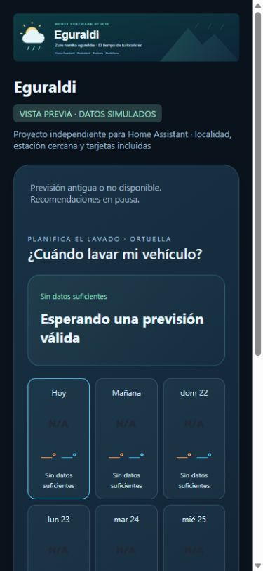

# Revisión de fiabilidad · 0.6.2

Revisión interna del 20 de noviembre de 2026. Se han corregido fallos reproducidos con HA 2026.11.1 y respuestas simuladas. No implica certificación de Home Assistant, aprobación de HACS ni revisión externa.

## Problemas corregidos

| Situación | Comportamiento corregido |
| --- | --- |
| Observaciones correctas, pero falla la previsión | La última descarga correcta de cada previsión se conserva por separado. Una lectura actual no cambia la edad de una previsión fallida. |
| Previsión antigua | La horaria caduca a las 2 h desde su última descarga correcta; la diaria a las 6 h. La horaria también requiere una emisión del proveedor de como máximo 12 h, con tolerancia de 5 min si adelanta su reloj. No se añaden consultas a la API. |
| Uso de la integración sin nuestras tarjetas | Las previsiones estándar de la entidad `weather` devuelven una lista vacía cuando caducan. Los valores almacenados no se presentan como una previsión vigente. Las observaciones conservan su disponibilidad independiente. |
| Datos inválidos o vacíos | No se consideran una previsión utilizable. Al volver datos válidos, se recuperan las previsiones sin reconfigurar la integración. |
| Falla una suscripción de tarjetas | La horaria y la diaria se suscriben por separado. Fallar una no impide la otra. Se reintenta la suscripción fallida cada 30 s, sin duplicar la que funciona. |
| Falla el catálogo de localidades | Se reintenta su carga, liberando antes la suscripción a eventos anterior. No se necesita cerrar y volver a abrir la tarjeta. |
| Cambio de configuración o desconexión de una tarjeta | Se vacía su caché de previsión, se cancelan reintentos y se ignoran respuestas pendientes de la generación anterior. |
| API rechaza credenciales | Un error de autenticación no queda oculto en la caché de un recurso opcional ni en la combinación de documentos horarios. HA puede iniciar la reautenticación existente. |
| Descarga o recarga de la integración | Se cancela el temporizador del coordinador antes de cerrar su cliente. |
| Avisos de ropa tendida | También se pausan si el coordinador informa de un fallo de actualización. No se envían notificaciones reales en las pruebas. |

## Información disponible para cualquier panel

En los atributos de la entidad meteorológica:

- `forecast_hourly_updated` y `forecast_daily_updated`: instante UTC de la última descarga correcta de cada previsión.
- `forecast_hourly_stale` y `forecast_daily_stale`: previsión no vigente o no utilizable.

Las tarjetas incluidas pausan las recomendaciones al caducar esos datos y muestran un estado breve que explica el motivo. No se añade una nota permanente al pie. Los atributos permiten construir automatizaciones o usar otros paneles sin nuestras tarjetas.

## Diagnósticos

El archivo de diagnóstico incluye la versión, el resultado de la última actualización, los recursos que han fallado y el estado de caducidad de las previsiones. Se ocultan también nombres y coordenadas de estación, distancia y estación recomendada, además de credenciales y localidad. No se incluyen las opciones que contienen destinatarios o entidades personales de Microclima.

## Evidencia y límites

Las pruebas reproducen caducidad, recuperación, fallos de suscripción, respuestas pendientes tras desconectar, error de autenticación, cancelación y conservación de opciones al reautenticar. Las pruebas anteriores de cambio de localidad, estación, entrenamiento y sesiones de ropa se mantienen.

No se han revocado las credenciales reales ni provocado una caída de la API en la casa del usuario. La validación real se limita a instalación, arranque, datos actuales, atributos de vigencia y conservación de Microclima y avisos. Las recomendaciones siguen siendo heurísticas; la revisión no demuestra por sí sola la mejora de Microclima.

Pendiente: matriz de pruebas con todas las versiones de HA declaradas compatibles, pruebas reales en otras instalaciones y validación de Microclima con suficientes días. Las tarjetas adicionales de radar, polen, mar e históricos no se han sometido en esta revisión a todos los escenarios de caída prolongada de sus proveedores.

## Estado visual ante datos caducados

Ejemplo de demostración con datos simulados; no corresponde a una caída real del HA del usuario.

